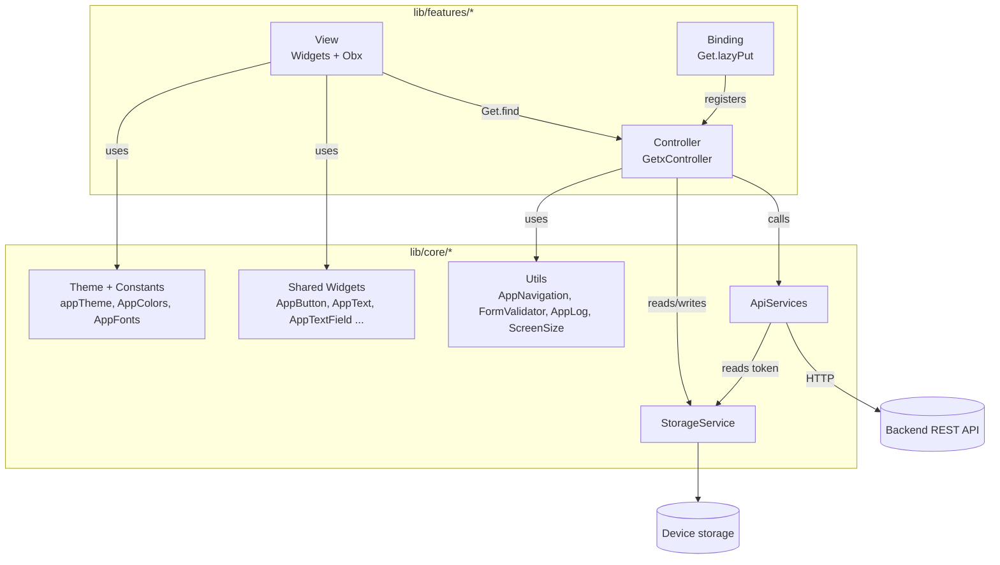
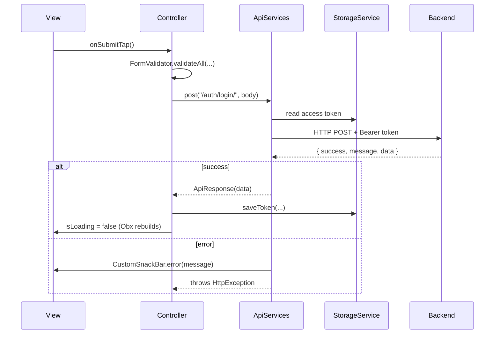

# starter

A Flutter starter template built with **GetX**. It comes with an API layer, local storage, auth screens, a tab-based home shell, a theme, and a set of reusable widgets, so a new app can begin with feature work right away.

---

## Table of Contents

- [Tech Stack](#tech-stack)
- [Architecture](#architecture)
  - [Which architecture and why](#which-architecture-and-why)
  - [Layers](#layers)
  - [Request flow](#request-flow)
  - [App startup flow](#app-startup-flow)
  - [Navigation (tab shell)](#navigation-tab-shell)
- [Folder Structure](#folder-structure)
- [The `core` Folder Explained](#the-core-folder-explained)
  - [bindings](#corebindings)
  - [services/api](#coreservicesapi)
  - [util](#coreutil)
  - [constants](#coreconstants)
  - [themes](#corethemes)
  - [routes](#coreroutes)
  - [background](#corebackground)
  - [user_profile](#coreuser_profile)
  - [widgets](#corewidgets)
- [Adding a New Feature](#adding-a-new-feature)
- [Getting Started](#getting-started)

---

## Tech Stack

| Purpose                | Package                    |
| ---------------------- | -------------------------- |
| State management + DI  | `get` (GetX)               |
| Local key-value store  | `get_storage`              |
| HTTP                   | `http`, `http_parser`      |
| Routing (prepared)     | `go_router`                |
| Fonts                  | `google_fonts`             |
| Responsive sizing      | `flutter_screenutil` + custom `ScreenSize` extension |
| Charts                 | `fl_chart`                 |
| Misc                   | `intl`, `uuid`, `dotted_border` |

---

## Architecture

### Which architecture and why

The project uses a **feature-first architecture with the GetX MVC pattern** (Model – View – Controller), plus a shared **`core`** layer.

- **Feature-first:** every screen area (auth, home, projects, chat, profile) lives in its own folder under `lib/features/`, with its own views, controllers, and bindings. You can work on one feature without touching the others, and deleting a feature means deleting one folder.
- **GetX MVC:**
  - **View**: Flutter widgets that only draw the UI and react to state with `Obx`.
  - **Controller**: a `GetxController` that holds state (`.obs` values), handles user actions, and calls services.
  - **Model**: plain Dart classes that parse JSON (for example `ApiResponseModel<T>`).
  - **Binding**: registers the controllers with GetX dependency injection, so views get them with `Get.find()` instead of creating them.
- **Core layer:** anything used by more than one feature (networking, storage, theme, colors, shared widgets) goes in `lib/core/`. Features depend on `core`, but `core` never depends on a feature (the only exception is `AppBindings`, which wires feature bindings together at startup).

Why this setup:

- **Separation of concerns.** UI code has no HTTP or storage logic, and controllers have no widget code.
- **Easy to test.** Controllers and `ApiServices` are plain classes, and `ApiServices` accepts an injectable `http.Client`.
- **Consistent UI.** All screens share one theme, one color palette, and the same buttons, text, and dialogs.
- **Less boilerplate.** Auth headers, logging, error snackbars, and JSON unwrapping are handled once in `ApiServices`.

### Layers



### Request flow

This is what happens when a controller calls the API (for example, sign in):



### App startup flow

`lib/main.dart` runs these steps in order:

1. `Get.put(ApiServices(baseUrl: ...))` registers one shared API client for the whole app.
2. Sets the status bar and navigation bar style.
3. `await GetStorage.init()` opens local storage.
4. `AppBindings.init()` registers every feature's controllers.
5. Starts `GetMaterialApp` with `appTheme` and the global `AppNavigation.navigatorKey`.
6. Chooses the first screen: `BasePage` if `StorageService.hasToken`, otherwise `SignInScreen`.

### Navigation (tab shell)

After login the user lands on `BasePage` (`lib/features/base/`), which works like this:

- An `IndexedStack` holds **four nested `Navigator`s** (Home, Projects, Latti AI, Account), so each tab keeps its own page history and scroll position.
- `AppNavigationBar` (from `core/widgets`) switches tabs through `BaseController.onTabSelected`.
- **Double-tapping** the active tab pops that tab back to its first page.
- The Android back button pops inside the current tab first, and only leaves the app when the tab is already at its root.

---

## Folder Structure

```text
lib/
├── main.dart                     # App entry: DI, storage init, theme, first screen
├── core/                         # Shared code used by all features
│   ├── background/               # Decorative backgrounds
│   ├── bindings/                 # App-wide dependency registration
│   ├── constants/                # Colors, fonts, asset paths, endpoints, language codes
│   ├── routes/                   # go_router config + page transitions
│   ├── services/api/             # HTTP client + response models
│   ├── themes/                   # Global ThemeData
│   ├── user_profile/             # User model/controller template
│   ├── util/                     # Storage, navigation, logging, validation, sizing
│   └── widgets/                  # Reusable UI components
└── features/                     # One folder per feature
    ├── auth/
    │   ├── controllers/          # SignIn, SignUp, Otp, ForgotPassword, ResetPassword
    │   ├── di/                   # AuthBinding
    │   ├── views/                # Auth screens
    │   └── widgets/              # Auth-only widgets (OtpInputRow)
    ├── base/                     # Bottom-nav shell (BasePage + BaseController)
    ├── home/
    ├── projects/
    ├── ai_chat/
    └── profile/
```

---

## The `core` Folder Explained

Each section below lists the classes in one `core` subfolder: what each class does, and why you would use it.

### `core/bindings`

| Class | What it does | Why use it |
| ----- | ------------ | ---------- |
| `AppBindings` (`app_bindings.dart`) | Has one static `init()` that calls every feature's binding (`AuthBinding`, `BaseBinding`, ...). Called once in `main()`. | Gives one place to register all controllers, so `Get.find<XController>()` works anywhere. When you add a feature, add its binding here. |

### `core/services/api`

| Class | What it does | Why use it |
| ----- | ------------ | ---------- |
| `ApiServices` (`services/api_services.dart`) | The single HTTP client. Offers `get`, `post`, `put`, `patch`, `delete`, plus `postFormData` / `putFormData` / `patchFormData` for uploading a file. Adds JSON headers and `Authorization: Bearer <token>` automatically, logs every request and response, and unwraps the `{ success, message, data }` response shape. | Controllers never repeat headers, token handling, JSON decoding, or error UI. On failure it shows an error snackbar and throws, so a controller only needs `try/finally` to reset its loading state. |
| `ApiResponse` (`services/api_services.dart`) | The value returned on success: `statusCode`, `isSuccess`, `message`, `data`. Helpers: `asMap`, `asList`, `get<T>('key')`. | Lets you read data safely, for example `response.get<String>('token')`, without manual casting. |
| `HttpException` (`services/api_services.dart`) | Thrown when the server returns a non-2xx status or `success: false`. Holds `message`, `statusCode`, `uri`, `body`, `status`. | Lets a controller react to specific failures, for example a 401 or a `status` like `resend_activation`. |
| `ApiResponseModel<T>` (`models/api_response_model.dart`) | A typed wrapper over the same response shape. Build it with `fromJson`, `fromApiResponse`, or `fromList` for lists. | Turns raw `data` into your own model classes (`ApiResponseModel<User>`, `ApiResponseModel<List<Project>>`) in one line. |

Example:

```dart
final _api = Get.find<ApiServices>();

try {
  isLoading.value = true;
  final res = await _api.post('/auth/login/', body: {'email': email, 'password': password});
  await StorageService.saveToken(res.get<String>('token')!);
} on HttpException {
  // Snackbar is already shown by ApiServices
} finally {
  isLoading.value = false;
}
```

### `core/util`

| Class | What it does | Why use it |
| ----- | ------------ | ---------- |
| `StorageService` (`storage_service.dart`) | Static wrapper around `GetStorage`. Saves and reads the access token, refresh token, and user role. Also has `hasToken`, `clearToken()`, and `logout()`; `logout()` erases everything except the saved language. | One place for persisted keys, so key names are never mistyped. `ApiServices` reads the token here, and `main.dart` uses `hasToken` to decide the first screen. |
| `AppNavigation` (`app_navigation.dart`) | Holds the global `navigatorKey` and helpers: `push`, `pop`, `pushReplacement`, `pushAndClear`. Pass a `context` to navigate inside the current tab (the bottom bar stays visible). Without a `context`, it uses the root navigator. | Lets controllers navigate without a `BuildContext`. `pushAndClear` is meant for logout or finishing onboarding, where the back stack must be wiped. |
| `AppLog` (`app_log.dart`) | Pretty, boxed console logs: `request`, `response`, `error`, `info`. Wrapped in `assert`, so it **only runs in debug builds**. | Readable API debugging, with no logs (or leaked data) in release builds. |
| `FormValidator` + `FormFieldEntry` (`form_validator.dart`) | `validateField` / `validateAll` check that fields are not empty, show a snackbar, and focus the first invalid field. Also `isValidEmail` and `isValidPassword` (at least 8 characters and one uppercase letter). | Same validation behavior on every form, without needing `Form` + `GlobalKey<FormState>`. |
| `ScreenSize` extension (`screen_size.dart`) | Adds `context.w()`, `context.h()`, `context.sp()` to scale sizes from a 393×852 design (Figma). Also adds `isTabletDevice`, `pagePadding`, `maxContentWidth`, `gridColumns`, and spacing presets (`spacing8`, `spacing16`, ...). | Pixel values from the design scale correctly on small phones and are capped on tablets, so the layout doesn't stretch. |
| `DashedBorderPainter` (`dashed_border_painter.dart`) | A `CustomPainter` that draws a dashed rounded-rectangle border. | For upload boxes, empty states, or "add new" cards that need a dashed outline. |

### `core/constants`

| Class / file | What it does | Why use it |
| ------------ | ------------ | ---------- |
| `AppColors` (`app_colors.dart`) | Every color in the app as `static const` values: brand, text, status (success, warning, danger) and their background tints, borders, and so on. | One source of truth for colors. Changing a brand color is a one-line edit, and screens never hard-code hex values. |
| `AppFonts` (`app_fonts.dart`) | Font family names (`outfit`, `cormorantGaramond`). | Avoids typos in font names. These must match the `fonts:` section in `pubspec.yaml`. |
| `AppConstant` (`app_constant.dart`) | `baseUrl` and full API endpoint URLs (register, forgot password, OTP, onboarding, home ...). | Keeps endpoints in one place, so a URL change doesn't require searching the codebase. |
| `AppAssertImage` (`app_assert_image.dart`) | Singleton with asset paths for icons and images (`AppAssertImage.instance.appLogo`). | Type-safe asset paths and autocomplete instead of raw strings. |
| `AppImages` (`images.dart`) | Static asset paths (older style, used for splash images). | Same purpose as `AppAssertImage`. New assets should go into one of the two, not both. |
| `kLangCodes` (`lang_codes.dart`) | List of supported language codes; languages without translations fall back to English. | Ready for a language picker or localization setup. |

### `core/themes`

| Item | What it does | Why use it |
| ---- | ------------ | ---------- |
| `appTheme` (`themes.dart`) | The global Material 3 `ThemeData`: color scheme from `AppColors`, Plus Jakarta Sans text theme, and styles for app bars, cards, all button types, inputs, the bottom nav bar, snackbars, and progress indicators. | Plain Flutter widgets (`ElevatedButton`, `TextField`, `Card` ...) match the design automatically without extra styling. |

### `core/routes`

| Item | What it does | Why use it |
| ---- | ------------ | ---------- |
| `appRouter` (`app_router.dart`) | A `GoRouter` instance with an empty route list. **Not wired in yet**: the app currently navigates with `GetMaterialApp` + `AppNavigation`. | Ready for when you need URL-based routing, deep links, or web support. |
| `pattoTransitionPage` / `pattoTransitionsBuilder` (`patto_page_transitions.dart`) | A 280 ms fade + slide-from-right page transition for `go_router` (`CustomTransitionPage`). | Gives every route the same, smooth animation once `go_router` is used. |

### `core/background`

| Class | What it does | Why use it |
| ----- | ------------ | ---------- |
| `StarryBackground` (`starry_background.dart`) | A gradient background with randomly placed stars. Star count, size, opacity, colors, and random seed are configurable, and it can wrap a `child`. | A ready-made decorative background for splash, onboarding, or hero screens. |

### `core/user_profile`

| Class | What it does | Why use it |
| ----- | ------------ | ---------- |
| `UserController` / `UserProfile` | **Commented-out templates**: a profile model (`fromJson`, `toJson`, `copyWith`) and a controller that fetches the logged-in user. | A starting point when you connect a real "current user" endpoint. Uncomment it and switch the request to `ApiServices`. |

### `core/widgets`

Reusable UI building blocks. They use `AppColors`, `AppText`, and `ScreenSize`, so every screen looks the same.

**Text and input**

| Widget | What it does | Why use it |
| ------ | ------------ | ---------- |
| `AppText` (`text/app_text.dart`) | The standard text widget. Use the main constructor for full control, or the presets `AppText.display(...)` for headings and `AppText.body(...)` for body text. Font size is responsive by default. | Every text in the app uses the same fonts, sizes, and colors without repeating `TextStyle`. |
| `AppTextField` (`text/text_field/AppTextFiled.dart`) | A text input with a label, an optional right-side label action (for example "Forgot password?"), prefix and suffix icons, password mode, a validator, and custom colors and borders. | One consistent input design for every form. |
| `AppSearchBar` (`app_search_bar.dart`) | A rounded search input with a search icon and `onChanged`. | Drop-in search for list screens. |
| `MathText` (`text/math_text.dart`) | **Commented out.** Renders text mixed with LaTeX math (needs `flutter_math_fork`). | Keep it in case the app needs math content. |

**Buttons**

| Widget | What it does | Why use it |
| ------ | ------------ | ---------- |
| `AppButton` (`buttons/app_button.dart`) | The main call-to-action button: press animation (scales down and fades slightly), built-in loading state, prefix and suffix icons, and custom colors and sizes. Also has `AppButton.buildLoadingOverlay(isLoading: ...)` for a full-screen loading card. | Every primary action looks and feels the same, and showing a loading state is one flag. |
| `SocialButton` (`buttons/social_login_buttons.dart`) | An outlined button with an image or icon plus text, used for "Continue with Google / Apple". | Ready for social login rows. |
| `CustomAppButton` (`buttons/custom_button.dart`) | **Commented out.** An older button that used an image background. | Kept for reference; use `AppButton` instead. |

**Navigation and structure**

| Widget | What it does | Why use it |
| ------ | ------------ | ---------- |
| `AppNavigationBar` (`bottom_navigation/bottom_navigation.dart`) | The 4-tab bottom bar (Home, Projects, Latti AI, Account) with active and inactive icons, a small "pop" scale animation on tap, and animated color and label changes. | Used by `BasePage`; edit the icon and label lists here to change the tabs. |
| `AppDrawer` (`app_drawer.dart`) | The side drawer. Shows the user's name and role, and shows or hides menu items depending on `StorageService.userRole`. | Role-based menu in one place. |
| `BuildAppBar` (`app_bar/build_app_bar.dart`) | A custom `PreferredSizeWidget` app bar with an optional back button, title, notification bell, and avatar. | Use it as `Scaffold.appBar` for a consistent header. |
| `BuildSliverAppBar` (`app_bar/build_sliver_app_bar.dart`) | A floating `SliverAppBar` with an optional back button, title, and profile image. | For scrolling screens built with `CustomScrollView`. |

**Feature page kit** (import everything at once with `feature/feature_widgets.dart`)

| Widget | What it does | Why use it |
| ------ | ------------ | ---------- |
| `FeaturePageShell` | A `Scaffold` with the app's gradient background and soft glow circles. | Wrap any feature screen in it to get the standard background. |
| `FeatureAppBar`, `FeatureIconButton`, `FeatureQuietLabel` | A lightweight in-page header with a back button and trailing slot, a round icon button, and a small muted label. | Headers for screens built on `FeaturePageShell`. |
| `FeatureHeroCard`, `FeatureModeCard` | A large gradient "hero" card for the top of a page, and a soft tinted action tile. | For dashboards and home-style layouts. |
| `FeatureListCard`, `FeatureSeparatedList`, `FeatureBadge` | A list row card (title, subtitle, leading badge, optional progress bar, chevron, selected state), a spaced `ListView` with optional header and footer, and a small pill badge. | Builds a consistent list screen quickly. |

**Dialogs, sheets, and feedback**

| Widget / class | What it does | Why use it |
| -------------- | ------------ | ---------- |
| `CustomSnackBar` (`snakbar/custom_snackbar.dart`) | Static `success`, `error`, `warning`, `info` snackbars with an icon, a color, and floating style. Uses `Get.context`, so it works from controllers. | One-line user feedback from anywhere. `ApiServices` and `FormValidator` already use it. |
| `AppDialog` (`dialog/app_dialog.dart`) | A confirm/cancel dialog with a title and description. Its width adapts on tablets. | For "Are you sure?" confirmations. |
| `SuccessDialog` (`app_dialog.dart`) | A dialog with an image, title, description, and one action button. | For "Done!" or "Password changed" moments. |
| `PattoBottomSheet` (`sheets/patto_bottom_sheet.dart`) | A bottom sheet with rounded top corners and a drag handle. Open it with `PattoBottomSheet.show(...)`. | Every bottom sheet in the app looks the same. |
| `PremiumPaywallSheet` (`Drawer/app_drawer.dart`) | A premium upgrade bottom sheet with a monthly/yearly toggle and plan cards. Open it with `PremiumPaywallSheet.show(context)`. | Ready-made paywall UI. |
| `GuestOverlay` (`guest_overlay/guest_overlay.dart`) | **Commented out.** Blurs a page and shows a "sign in / sign up" card when the user isn't logged in. | Useful if some screens should be visible but locked for guests. |

**Dividers**

| Widget | What it does | Why use it |
| ------ | ------------ | ---------- |
| `LineDivider` (`divider/divider.dart`) | A horizontal dashed line. | A light separator between sections. |
| `TextDivider` (`divider/text_divider.dart`) | A line with text in the middle (default "or"). | The classic "— or —" between login options. |

---

## Adding a New Feature

Example: an `orders` feature.

1. Create the folders:

   ```text
   lib/features/orders/
   ├── binding/orders_binding.dart
   ├── controllers/orders_controller.dart
   ├── models/order.dart
   └── views/orders_page.dart
   ```

2. Write the controller and use the core services:

   ```dart
   class OrdersController extends GetxController {
     final _api = Get.find<ApiServices>();
     final orders = <Order>[].obs;
     final isLoading = false.obs;

     @override
     void onInit() {
       super.onInit();
       fetchOrders();
     }

     Future<void> fetchOrders() async {
       isLoading.value = true;
       try {
         final res = await _api.get('/orders/');
         orders.assignAll(res.asList!.map((e) => Order.fromJson(e)));
       } finally {
         isLoading.value = false;
       }
     }
   }
   ```

3. Register it in a binding:

   ```dart
   class OrdersBinding {
     static void dependencies() {
       Get.lazyPut<OrdersController>(() => OrdersController(), fenix: true);
     }
   }
   ```

4. Call `OrdersBinding.dependencies()` inside `AppBindings.init()`.

5. In the view, get the controller with `Get.find<OrdersController>()`, wrap reactive parts in `Obx`, and build the UI from `core/widgets`.

---

## Getting Started

1. Install the [Flutter SDK](https://docs.flutter.dev/get-started/install) (Dart `^3.13.0`).
2. Install dependencies:

   ```bash
   flutter pub get
   ```

3. Set your backend URL in `lib/main.dart` (currently the placeholder `"baseUrl"`):

   ```dart
   Get.put(ApiServices(baseUrl: "https://your-api.com/api"));
   ```

4. Run the app:

   ```bash
   flutter run
   ```
